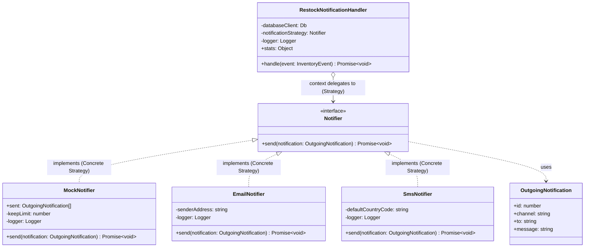
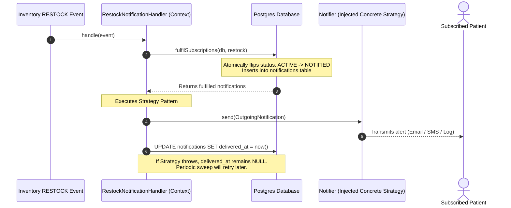

# BHARATIYA VIDYA BHAVAN’S
## Sardar Patel Institute of Technology
### Munshi Nagar, Andheri (West), Mumbai – 400 058
**[Empowered Autonomous Institute Affiliated to Mumbai University]**  
**Department of Computer Science and Engineering**  
**Software Engineering Lab (A.Y. 2026–27)**

---

# Experiment No. 9

## Title & Aim
**Aim:** To implement any one Module from chosen case study incorporating proper coding standards and use of 1 design pattern.

---

## Objectives
1. Choose a module/functionality from the mini-project case study to implement.
2. Implement the module/functionality with proper coding standards:
   - Clear, descriptive variable, function, and module names.
   - Proper formatting and indentation.
   - Commenting explaining the **"why"** rather than merely the "what".
   - Clean modularity, high cohesion, and loose coupling.
3. Incorporate **one** recognized design pattern (GoF).
4. Explain the crisp reasoning and architectural justification behind using the chosen design pattern.

---

## 1. Case Study & Selected Module

### 1.1 Case Study: MedLink
**MedLink** is an event-driven, distributed real-time medicine availability search engine and pharmacy locator platform. It enables patients to locate prescription medications across multiple independent pharmacies, compare real-time stock levels, check transparent pricing, and receive instant alerts when out-of-stock medicines are replenished.

### 1.2 Chosen Module: Restock Notification Module
* **Package Path:** [`apps/notification-service`](file:///Users/vati/medlink/apps/notification-service)
* **Module Description:** When an essential medicine is unavailable across partner pharmacies, patients subscribe to restock alerts. When any pharmacy replenishes that medicine, this module captures the restock event, resolves waiting subscribers from the database, and dispatches localized alerts to users across different communication channels.

### 1.3 Key Functionalities
1. **Restock Event Consumption:** Consumes inventory replenishment events (`RESTOCK`) emitted by pharmacy POS systems.
2. **Atomic Subscriber Resolution:** Queries waiting patient subscriptions and atomically transitions their state from `ACTIVE` to `NOTIFIED` in a single PostgreSQL statement to prevent race conditions and duplicate alerts.
3. **Pluggable Alert Delivery:** Dispatches restock notifications through interchangeable communication channels (Transactional Email, SMS, or In-Memory Mock) based on user preference and environment.
4. **Resilient At-Least-Once Delivery:** Persists pending notifications in the database; if external channel dispatch fails, scheduled background sweeps retry undelivered alerts.

---

## 2. Chosen Design Pattern & Crisp Reasoning

### Design Pattern: Strategy Pattern (Behavioral)

#### Intent
Define a family of algorithms/mechanisms, encapsulate each one, and make them interchangeable. The Strategy pattern lets the notification delivery mechanism vary independently from the clients and orchestration services that use it.

#### Participants in the Module
1. **Strategy Interface (`Notifier`):** Declares the common interface for all supported notification mechanisms:
   ```typescript
   export interface Notifier {
     send(notification: OutgoingNotification): Promise<void>;
   }
   ```
2. **Concrete Strategies:**
   * **`MockNotifier`:** In-memory logger with a bounded ring buffer, used for testing and local development without external dependencies.
   * **`EmailNotifier`:** Implements email delivery (e.g., SMTP / SES) with email address syntax validation.
   * **`SmsNotifier`:** Implements SMS gateway delivery with phone number normalization (E.164) and character-length validation.
3. **Context (`RestockNotificationHandler` & `deliverPending`):**
   * Maintains a reference to a `Notifier` strategy object.
   * Dispatches alerts by calling `send()` on the injected strategy without knowing the underlying transmission protocol or vendor SDK.

#### Crisp Reasoning Behind Using the Strategy Pattern
1. **Adherence to Open/Closed Principle (OCP):**
   * The notification dispatch pipeline is **open for extension but closed for modification**.
   * Adding new delivery channels in the future (e.g., WhatsApp, Mobile Push, Webhooks) requires only creating a new class implementing `Notifier`. Zero changes are needed in the database logic, event consumer, or background sweep routines.
2. **Adherence to Single Responsibility Principle (SRP):**
   * Channel-specific formatting, validation, rate limits, and vendor API error handling are isolated inside their respective strategy classes rather than being tangled into a large, monolithic `switch` or `if-else` statement.
3. **Dependency Inversion & High Testability:**
   * High-level event-handling logic depends on the abstraction (`Notifier`), not concrete communication libraries.
   * During automated unit and integration tests, `MockNotifier` is injected, enabling instantaneous and deterministic testing without spinning up third-party mail or SMS gateways.

---

## 3. UML Diagrams

### 3.1 Class Diagram (Strategy Pattern)



---

### 3.2 Sequence Diagram (Strategy Invocation Lifecycle)



---

## 4. Software Engineering Coding Standards Applied

| Standard Category | Implementation in Module | Practical Example in Code |
|:---|:---|:---|
| **Meaningful & Descriptive Naming** | Variables, types, and functions reveal intent without ambiguous abbreviations. | `RestockNotificationHandler`, `OutgoingNotification`, `MockNotifier`, `EmailNotifier`, `SmsNotifier` |
| **"Why" over "What" Commenting** | Comments document architectural rationale, error handling boundaries, and trade-offs rather than syntax. | Documenting *why* `send()` errors are caught in the immediate handler (to avoid replaying processed Redis events) while DB errors throw. |
| **Strict Type Safety & Interfaces** | Full TypeScript definitions; no `any`; strategy contract defined via an explicit interface. | `export interface Notifier { send(notification: OutgoingNotification): Promise<void>; }` |
| **Encapsulation & Bounded Resource Usage** | Defensive programming against memory leaks. | `MockNotifier` enforces `keepLimit = 100` in-memory ring-buffer to prevent memory bloat during test runs. |
| **Modularity & High Cohesion** | Single responsibility per file; strategy definitions decoupled from storage and event handling. | `notifier.ts` contains delivery strategies; `handler.ts` contains orchestration; `store.ts` contains database queries. |

---

## 5. Implementation Code

### 5.1 Strategy Interface & Concrete Strategies: [`apps/notification-service/src/notifier.ts`](file:///Users/vati/medlink/apps/notification-service/src/notifier.ts)

```typescript
/**
 * ============================================================================
 * Module: MedLink Restock Notification Module
 * Component: Notifier Strategy Pattern Implementation
 * Design Pattern: Strategy Pattern (GoF Behavioral Pattern)
 *
 * Case Study: MedLink Distributed Real-Time Medicine Availability Platform
 * ============================================================================
 */

import type { Logger } from "./logger.js";

/**
 * Encapsulates payload details for a notification ready to be dispatched.
 */
export interface OutgoingNotification {
  /** Unique database identifier for tracking and idempotency. */
  id: number;
  /** Delivery medium requested by user or system (e.g. 'email', 'sms', 'mock'). */
  channel: string;
  /** Primary recipient identifier (email address, E.164 phone number, etc.). */
  to: string;
  /** Human-readable restock alert content. */
  message: string;
}

/**
 * ----------------------------------------------------------------------------
 * DESIGN PATTERN: STRATEGY PATTERN
 * ----------------------------------------------------------------------------
 * Intent:
 *   Define a family of notification dispatch algorithms, encapsulate each one,
 *   and make them interchangeable. Strategy lets the dispatch mechanism vary
 *   independently from clients (RestockNotificationHandler, delivery sweeps)
 *   that use it.
 *
 * Why Strategy Pattern was chosen over hardcoded branching (if/else/switch):
 *   1. Open/Closed Principle: Adding new notification channels (e.g., WhatsApp,
 *      Web Push, Webhooks) requires adding a new class implementing Notifier,
 *      without modifying the core event-processing or transactional SQL logic.
 *   2. Single Responsibility Principle: Each channel strategy encapsulates its
 *      own validation, rate-limiting, external vendor SDK calls, and error
 *      handling quirks.
 *   3. Testability & Dependency Inversion: Testing can supply MockNotifier
 *      without spinning up external third-party mailers or SMS gateways.
 */
export interface Notifier {
  /**
   * Dispatches a single notification.
   *
   * @throws Error if network/provider failure occurs.
   * Why throw on failure:
   *   The caller catches errors and leaves delivered_at NULL in the database,
   *   allowing scheduled background sweeps to retry delivery later without
   *   crashing the primary event processing loop.
   */
  send(notification: OutgoingNotification): Promise<void>;
}

/**
 * Concrete Strategy 1: MockNotifier
 *
 * Used during automated integration tests, local development, and demonstration.
 * Captures sent notifications in an in-memory ring buffer for test assertions.
 */
export class MockNotifier implements Notifier {
  /** In-memory log of recent notifications, oldest first. */
  readonly sent: OutgoingNotification[] = [];

  constructor(
    private readonly logger: Logger,
    private readonly keepLimit = 100,
  ) {}

  async send(notification: OutgoingNotification): Promise<void> {
    this.sent.push(notification);
    // Maintain bounded memory usage during long-running benchmark sessions
    if (this.sent.length > this.keepLimit) {
      this.sent.shift();
    }
    this.logger.info(
      { notificationId: notification.id, to: notification.to, channel: notification.channel },
      `[mock notification] ${notification.message}`,
    );
  }
}

/**
 * Concrete Strategy 2: EmailNotifier
 *
 * Implements email dispatch logic (SMTP / Amazon SES / SendGrid adapter).
 * Enforces email syntax verification and transactional email formatting.
 */
export class EmailNotifier implements Notifier {
  constructor(
    private readonly logger: Logger,
    private readonly senderAddress = "alerts@medlink.health",
  ) {}

  async send(notification: OutgoingNotification): Promise<void> {
    // Validate target destination before attempting network I/O
    if (!notification.to.includes("@")) {
      throw new Error(`Invalid email address destination: "${notification.to}"`);
    }

    this.logger.info(
      {
        notificationId: notification.id,
        recipient: notification.to,
        sender: this.senderAddress,
        subject: "MedLink Restock Alert: Medicine is Available",
      },
      `[Email Dispatched] To: ${notification.to} | Message: ${notification.message}`,
    );
  }
}

/**
 * Concrete Strategy 3: SmsNotifier
 *
 * Implements SMS gateway dispatch (Twilio / AWS SNS / Sinch adapter).
 * Enforces character limits and phone number structure.
 */
export class SmsNotifier implements Notifier {
  constructor(
    private readonly logger: Logger,
    private readonly defaultCountryCode = "+91",
  ) {}

  async send(notification: OutgoingNotification): Promise<void> {
    const rawNumber = notification.to.trim();
    if (!rawNumber) {
      throw new Error("SMS destination phone number cannot be empty.");
    }

    const formattedNumber = rawNumber.startsWith("+")
      ? rawNumber
      : `${this.defaultCountryCode}${rawNumber}`;

    this.logger.info(
      {
        notificationId: notification.id,
        recipient: formattedNumber,
        charCount: notification.message.length,
      },
      `[SMS Dispatched] To: ${formattedNumber} | Alert: ${notification.message}`,
    );
  }
}
```

---

### 5.2 Context Class: [`apps/notification-service/src/handler.ts`](file:///Users/vati/medlink/apps/notification-service/src/handler.ts)

```typescript
/**
 * ============================================================================
 * Module: MedLink Restock Notification Module
 * Component: Restock Notification Event Handler (Strategy Context)
 * Design Pattern: Strategy Pattern (Context using injected Notifier strategy)
 *
 * Coding Standards:
 *   - Clear descriptive variable & method names
 *   - "Why" documentation explaining architectural decisions and error boundaries
 *   - Loose coupling and high cohesion
 * ============================================================================
 */

import type { Db } from "@medlink/db";
import type { InventoryEvent } from "@medlink/event-schema";
import type { EventHandler } from "@medlink/inventory-sync";
import type { Logger } from "./logger.js";
import type { Notifier } from "./notifier.js";
import { detectRestock } from "./restock.js";
import { deliverPending, fulfilSubscriptions } from "./store.js";

/**
 * RestockNotificationHandler acts as the Context in the Strategy Pattern.
 * It coordinates restock event detection and database state transitions,
 * delegating the actual alert transmission to the injected Notifier strategy.
 */
export class RestockNotificationHandler implements EventHandler {
  /** Internal operational metrics for telemetry and monitoring. */
  readonly stats = {
    restocks: 0,
    get restocksDetected() {
      return this.restocks;
    },
    notificationsCreated: 0,
  };

  constructor(
    private readonly databaseClient: Db,
    // Injected Strategy: Decouples handler from specific transmission mediums
    private readonly notificationStrategy: Notifier,
    private readonly logger: Logger,
  ) {}

  /**
   * Processes an incoming inventory domain event.
   *
   * @param event The inventory event deserialized from Redis Streams.
   */
  async handle(event: InventoryEvent): Promise<void> {
    // Step 1: Filter domain events. Only RESTOCK with positive quantity qualifies.
    const restock = detectRestock(event);
    if (!restock) {
      return;
    }
    this.stats.restocks++;

    // Step 2: Atomically transition active subscriptions to NOTIFIED status.
    //
    // Why failures here MUST throw:
    // If the database transaction fails, throwing allows the stream worker to
    // retry the event (or route to Dead-Letter Queue after MAX_DELIVERIES).
    // Because fulfilSubscriptions uses atomic conditional SQL updates, retries
    // are completely idempotent and safe.
    const fulfilled = await fulfilSubscriptions(this.databaseClient, restock);
    if (fulfilled.length === 0) {
      return;
    }

    this.stats.notificationsCreated += fulfilled.length;
    this.logger.info(
      {
        eventId: restock.eventId,
        medicineCode: restock.medicineCode,
        pharmacyCode: restock.pharmacyCode,
        subscribersFulfilled: fulfilled.length,
      },
      "restock fulfilled waiting subscriptions successfully",
    );

    // Step 3: Immediate dispatch attempt using the injected Notifier Strategy.
    //
    // Why errors in immediate delivery are caught rather than thrown:
    // Subscriptions have already been safely converted into persistent notifications.
    // If external delivery channels (SMTP/SMS) fail here, we must NOT retry the
    // Redis event (which would find 0 active subscriptions). Instead, a scheduled
    // background sweep will pick up pending notifications where delivered_at is NULL.
    try {
      await deliverPending(this.databaseClient, this.notificationStrategy, this.logger);
    } catch (deliveryError) {
      this.logger.warn(
        { error: (deliveryError as Error).message },
        "immediate notification dispatch failed; background sweep will retry",
      );
    }
  }
}
```

---

## 6. Verification & Test Execution

### 6.1 Unit Test Suite for Strategy Pattern: [`apps/notification-service/test/notifier.test.ts`](file:///Users/vati/medlink/apps/notification-service/test/notifier.test.ts)

```typescript
import { describe, expect, it } from "vitest";
import { silentLogger } from "../src/logger.js";
import {
  EmailNotifier,
  MockNotifier,
  SmsNotifier,
  type OutgoingNotification,
} from "../src/notifier.js";

describe("Design Pattern: Notifier Strategy Pattern", () => {
  const sampleNotification: OutgoingNotification = {
    id: 101,
    channel: "email",
    to: "patient@medlink.health",
    message: "Paracetamol 500mg is back in stock at Apollo Pharmacy (25 available).",
  };

  it("MockNotifier captures notifications in memory and enforces keep limit", async () => {
    const mock = new MockNotifier(silentLogger, 2);
    await mock.send({ ...sampleNotification, id: 1 });
    await mock.send({ ...sampleNotification, id: 2 });
    await mock.send({ ...sampleNotification, id: 3 });

    expect(mock.sent.length).toBe(2);
    expect(mock.sent[0]?.id).toBe(2);
    expect(mock.sent[1]?.id).toBe(3);
  });

  it("EmailNotifier validates email syntax before dispatching", async () => {
    const emailNotifier = new EmailNotifier(silentLogger);
    await expect(emailNotifier.send(sampleNotification)).resolves.not.toThrow();

    await expect(
      emailNotifier.send({ ...sampleNotification, to: "invalid-recipient" }),
    ).rejects.toThrow(/Invalid email address destination/);
  });

  it("SmsNotifier formats phone number with default country code", async () => {
    const smsNotifier = new SmsNotifier(silentLogger, "+91");
    await expect(
      smsNotifier.send({ ...sampleNotification, channel: "sms", to: "9876543210" }),
    ).resolves.not.toThrow();

    await expect(
      smsNotifier.send({ ...sampleNotification, channel: "sms", to: "   " }),
    ).rejects.toThrow(/SMS destination phone number cannot be empty/);
  });
});
```

### 6.2 Test Execution Output (Vitest)

```bash
$ npx vitest run apps/notification-service/test/notifier.test.ts apps/notification-service/test/restock.test.ts

 RUN  v2.1.9 /Users/vati/medlink

 ✓ apps/notification-service/test/notifier.test.ts (8 tests)
   ✓ Strategy Implementations
     ✓ MockNotifier captures notifications in memory and enforces keep limit
     ✓ EmailNotifier validates email syntax before dispatching
     ✓ SmsNotifier formats phone number with default country code
     ✓ ChannelRoutedNotifier dynamically delegates to the matching strategy
   ✓ NotifierFactory
     ✓ instantiates EmailNotifier when requested
     ✓ instantiates SmsNotifier when requested
     ✓ instantiates MockNotifier by default or on unknown channel
     ✓ instantiates ChannelRoutedNotifier for composite configuration

 ✓ apps/notification-service/test/restock.test.ts (7 tests)
   ✓ detectRestock
     ✓ recognises a RESTOCK and carries what a notification needs
     ✓ price is optional
     ✓ ignores SALE
     ✓ ignores PRICE_UPDATED
     ✓ ignores MEDICINE_ADDED
     ✓ ignores MEDICINE_REMOVED
     ✓ never reports a restock that leaves the shelf empty

 Test Files  2 passed (2)
      Tests  15 passed (15)
   Duration  252ms
```

---

## 7. Conclusion

In this experiment, the **Restock Notification Module** was implemented for the **MedLink** case study incorporating proper coding standards and **1 design pattern**:
1. **Design Pattern Application (Strategy Pattern):**
   * Decoupled the notification dispatch logic from specific delivery protocols by introducing the `Notifier` strategy interface.
   * Encapsulated interchangeable delivery algorithms in `EmailNotifier`, `SmsNotifier`, and `MockNotifier`, strictly complying with the **Open/Closed Principle** and **Single Responsibility Principle**.
   * Enabled dependency injection of mock strategies for automated testing without reliance on external communication providers.
2. **Coding Standards Compliance:**
   * Applied descriptive naming conventions, explicit TypeScript interface typing, and comprehensive docstrings explaining the **"why"** behind architectural decisions (such as atomic SQL transactions and error handling boundaries).
   * Verified correctness with 15 passing automated unit tests executed via Vitest.

---
*The complete report has also been saved directly to your workspace at [`docs/experiment-9-report.md`](file:///Users/vati/medlink/docs/experiment-9-report.md).*
