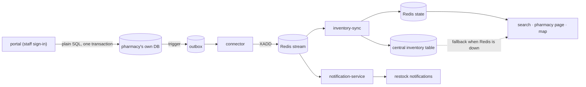

# Pharmacy portal

Where pharmacy staff sign in to change their stock: set the quantity on the shelf, change a price, list a medicine
or stop listing one. A change made here reaches **everything that shows stock**, because it travels the same way a
change from real pharmacy software does.



The portal **never writes to Redis or to MedLink's central inventory table**. It writes to the pharmacy's own
database through `@medlink/pharmacy-ops` (the same code the pharmacy simulator uses, so the validation and the
"no overselling" locking are shared), and the pipeline carries the change from there. It needs the connector and sync
service running (`npm run connector:start`, `npm run sync:start`); without them a change waits in the pharmacy's
outbox and is caught up when they start.

## Run it

```
npm run db:migrate                  # adds the pharmacy_users table
npm run portal:seed-users           # p001@pharmacy.test ... p005@pharmacy.test, password medlink-dev
npm run portal:dev                  # the portal API on :4200
npm run web:dev                     # the web app; the portal is at /portal ("Pharmacy staff sign in" in the footer)
```

(plus `npm run infra:up`, `pharmacies:setup`, `connector:start`, `sync:start` as for the rest of the pipeline.)

## What staff can do

| Action | Endpoint | Recorded as |
| --- | --- | --- |
| Set the quantity on the shelf | `PATCH /portal/stock/:code` `{ quantity }` | `SALE` if lower, `RESTOCK` if higher, nothing if equal |
| Change the price | `PATCH /portal/stock/:code` `{ price }` | `PRICE_UPDATED` |
| List a medicine | `POST /portal/stock` `{ medicineCode, quantity, price }` | `MEDICINE_ADDED` |
| Stop listing a medicine | `DELETE /portal/stock/:code` | `MEDICINE_REMOVED` |

Also `POST /portal/login`, `POST /portal/logout`, `GET /portal/me`, `GET /portal/stock` (read from the pharmacy's own
database) and `GET /portal/catalogue` (medicines the pharmacy does not list yet).

## Sign-in and who can change what

- Accounts live in the central `pharmacy_users` table: an email, a scrypt password hash and **one** pharmacy code.
- Signing in sets a signed (HMAC), `HttpOnly`, `SameSite=Lax` cookie holding the user and the pharmacy code. It
  expires after `PORTAL_SESSION_HOURS` (8). Every request also checks that the account still exists.
- The pharmacy is **always taken from the session**, never from the request, and request bodies are strict, so a
  P001 login cannot change P002's stock whatever it sends.
- Cross-origin requests are allowed only from `CORS_ORIGINS`, with credentials.

Not built, on purpose, for development: password reset, roles inside a pharmacy, sign-in rate limiting, an audit
trail of who changed what. Add them before real use. Set `PORTAL_SESSION_SECRET` (required when
`NODE_ENV=production`) and serve it over HTTPS (the cookie is then also `Secure`).

## The central table follows live stock

Search prefers live stock from Redis but falls back to the central `inventory` table when Redis is down or does not
know a medicine. So that the fallback is not stale, **inventory-sync copies every applied change into that table**
(when it has `DATABASE_URL`; `SYNC_MIRROR=off` disables it). See `apps/inventory-sync/src/mirror.ts`.

- It copies the item as Redis now has it (already ordered and de-duplicated), so repeating or reordering is harmless,
  and a row is only overwritten by something not older (`updated_at <= asOf`).
- It is best effort: a failure is logged and counted, not retried, because the Redis change and its dedup marker are
  already committed. The next change to the same medicine writes the then-current state.
- A seeded row is stamped with the seed time, so an event older than that does not overwrite it.
- This replaces the old unauthenticated `POST/PATCH /api/inventory` endpoints, which wrote only to this table and
  were overridden by live stock. They are gone; `GET /api/inventory` remains.
